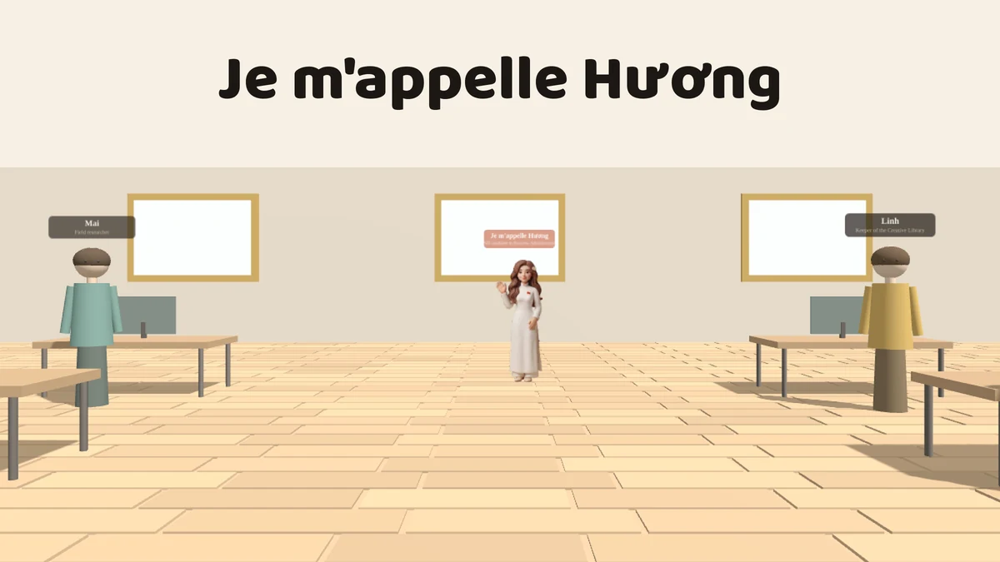

<p align="center">
  
  &nbsp;&nbsp;
  
</p>

# Le Bureau de Hương

**An offline 3D office with a mode-of-entry board for International Business teaching.**

*Formerly titled Research Office. The repository name, URL and DOI are unchanged.*

**A small 3D office that runs entirely in the browser and makes no network
request at all.** Visitors walk in, meet six characters, and read what the
author's dissertation studies. Every answer is written in advance by the author
and stored in the page. **Nothing is generated at run time.**

▶ **[Open the office](https://thuyhuongctu.github.io/Research-Office/)**

**Intro film (63 s).** The start screen has a *Watch the intro* button that
plays a one-minute tour of the office with English narration and captions
([`assets/video/le-bureau-intro.mp4`](assets/video/le-bureau-intro.mp4)).

[](https://doi.org/10.5281/zenodo.22971293)



---

## What is in the room

**Six characters.** Je m'appelle Hương is the author herself and answers eight
questions about the dissertation, the data frame and the courses she teaches.
The other five (Mai, Linh, Tùng, An and Minh) are **fictional characters**
carried over from the knowledge-estate scene of the author's academic homepage,
and every dialogue panel says so. They answer questions about the WBES × WGI data
frame, the publication list, the teaching software, and why the page makes no
network calls.

**Entry Mode Simulator**, in the far right-hand corner. It compares six entry
modes for the Japanese market. Visitors drag five priority sliders (control,
speed, learning, capital limit, risk tolerance) to re-score the modes, and can
place any two modes side by side. The figures are **illustrative** and come from
BizOn AIBIS, used with the co-author's consent (see *Licence and citation*
below).

**Settings panel** (the ⚙ button). It switches the dialogue panel between a
bottom card and a side column, shows the characters as paintings or clay
figures, and turns the minimap on or off. Choices are remembered.

**Mode-of-entry board**, on the right-hand wall beside a globe. Seven modes are
ordered by **rising resource commitment**, each anchored to a standard
International Business theory:

| Mode | Characteristic | Anchoring theory |
| --- | --- | --- |
| Export | low commitment, easy exit | Uppsala model |
| Licensing | grants the use of a right | transaction-cost economics |
| Franchising | scales through partners' capital | agency theory |
| Joint venture | shares risk, borrows local knowledge | CAGE framework |
| Strategic alliance | exchanges complementary resources | resource-based view |
| Digital platform | global from day one | born-global perspective |
| Greenfield FDI | maximum control, costly exit | OLI paradigm (Dunning) |

The office is used as **open teaching material** for an undergraduate
International Business course.

## Two languages

Vietnamese and English, switched with the button in the corner. English is the
default for every visitor; a visitor's own choice is remembered and always
takes precedence. Text reads the current language **at draw time**, so a panel
that is already open redraws correctly when the language changes.

## No network calls — measured, not promised

| | |
| --- | --- |
| `<script src>` / `<link href>` pointing outside the repository | **0** |
| Network calls at run time | **0** |
| Outgoing requests after load (measured in Chromium) | **0** |
| Analytics, advertising or third-party cookies | **0** |

The audio file on Minh's desk and the intro film are both declared
`preload="none"`, so neither is fetched when the page loads. Each is downloaded
only when a visitor presses play, and only from this repository.

There is no server and no build step: opening `index.html` is enough.

| File | Role |
| --- | --- |
| `index.html` | page layout, user interface, walking loop and panels |
| `assets/js/office-builder.js` | builds the 3D room and the clay figures |
| `assets/js/characters.js` | the cast and their pre-written answers |
| `assets/vendor/three-r128.min.js` | three.js, copied unmodified into the repository |
| `assets/img/logo/` | the round logo and the wordmark |
| `assets/video/` | the 63-second intro film and its poster |

## Running locally

```bash
python3 -m http.server 8899     # then open http://127.0.0.1:8899/
```

## Controls

| | |
| --- | --- |
| Walk | arrow keys or `W A S D`; on a phone, the round joystick |
| Talk | walk up to a character and press `E` |
| Close a panel | `Esc` |

---

## Origin

The work was first built in **[`thuyhuongctu/Je-mappelle-Huong`](https://github.com/thuyhuongctu/Je-mappelle-Huong)**,
the author's academic homepage, through three merges on **26 September 2026**:

| Commit | PR | Change |
| --- | --- | --- |
| `c3172a4` | #58 | Page rebuilt from scratch, replacing a machine-generated draft |
| `ae3ad30` | #59 | International Business corner and the mode-of-entry board added |
| `33d7d49` | #60 | Five characters replaced with the five people of the estate |

This repository is the **canonical version for citation**. The copy on the
homepage ([`/vanphong.html`](https://thuyhuongctu.github.io/Je-mappelle-Huong/vanphong.html))
is the display version within the homepage's own ecosystem.

## Licence and citation

**Author: thuyhuongctu (Đỗ Thùy Hương).**
**Copyright © 2026 Đỗ Thùy Hương. All rights reserved** — see [`LICENSE`](LICENSE).
The work is published for **reading, consultation and citation**. It is not
released under an open licence.

Third-party components: three.js r128 (MIT) and the Baloo 2 and Be Vietnam Pro
typefaces (SIL OFL 1.1), inventoried in full in [`THIRD-PARTY.md`](THIRD-PARTY.md).

**Material from `BizOn` (jointly owned).** The Entry Mode Simulator uses the
illustrative figures, the scoring formula and the "Lumina Insights" label of
BizOn AIBIS, a repository jointly owned by Đỗ Thùy Hương and Phan Anh Tú, with
the co-author's consent. That material is **excluded** from the sole-authorship
claim; see `THIRD-PARTY.md`, section 3.

Please cite using [`CITATION.cff`](CITATION.cff). The concept DOI,
**[10.5281/zenodo.22971293](https://doi.org/10.5281/zenodo.22971293)**, represents
every version and always resolves to the latest one; that is the DOI to cite.
Release `v1.0` alone has the DOI [10.5281/zenodo.22971294](https://doi.org/10.5281/zenodo.22971294).
